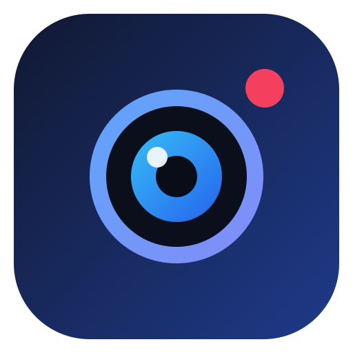

  
  <h1>NTK Cam Studio</h1>
  
Record your screen, webcam, slides, and voiceover together, then trim pauses and export finished videos on Windows, Android, or Web.

  

    
    
    
  

---

## Download the App (v1.0.0)

Pick the file that matches your device. Each link downloads the ready-to-run app directly.

| Device | Best Option | Direct Download | File Size |
| :--- | :--- | :--- | :--- |
| **Windows PC** | Full setup wizard with Desktop and Start Menu shortcuts (Recommended) | [Download `NTK-Cam-Studio-Setup-1.0.0.exe`](https://github.com/appdevmanwill/NTK-Cam-Studio/releases/latest/download/NTK-Cam-Studio-Setup-1.0.0.exe) | 116.7 MB |
| **Windows PC (No Install)** | Single portable app you can run from any folder or USB drive | [Download `NTK-Cam-Studio-Portable-1.0.0.exe`](https://github.com/appdevmanwill/NTK-Cam-Studio/releases/latest/download/NTK-Cam-Studio-Portable-1.0.0.exe) | 106.1 MB |
| **Android Phone / Tablet** | Direct Android app installer (`Android 7.0+`) | [Download `NTK-Cam-Studio-1.0.0.apk`](https://github.com/appdevmanwill/NTK-Cam-Studio/releases/latest/download/NTK-Cam-Studio-1.0.0.apk) | 4.1 MB |

Looking for older builds or checksums? Browse the [Latest GitHub Release page](https://github.com/appdevmanwill/NTK-Cam-Studio/releases/latest).

---

## How to Install

### Windows Installer (Recommended for PC)
1. Click [Download `NTK-Cam-Studio-Setup-1.0.0.exe`](https://github.com/appdevmanwill/NTK-Cam-Studio/releases/latest/download/NTK-Cam-Studio-Setup-1.0.0.exe).
2. Double-click the downloaded `.exe` file from your Downloads folder.
3. If Windows shows a SmartScreen security prompt, click **More info** and then click **Run anyway**.
4. Choose your install folder and complete the setup wizard to add Desktop and Start Menu shortcuts.

### Windows Portable (No Installation Needed)
1. Click [Download `NTK-Cam-Studio-Portable-1.0.0.exe`](https://github.com/appdevmanwill/NTK-Cam-Studio/releases/latest/download/NTK-Cam-Studio-Portable-1.0.0.exe).
2. Move the file to any folder or USB flash drive you prefer.
3. Double-click the file to launch the studio immediately. If Windows shows SmartScreen, click **More info** then **Run anyway**.

### Android Phone or Tablet
1. Open this page on your Android device and tap [Download `NTK-Cam-Studio-1.0.0.apk`](https://github.com/appdevmanwill/NTK-Cam-Studio/releases/latest/download/NTK-Cam-Studio-1.0.0.apk).
2. Open the downloaded `.apk` file from your browser notification or your **Files / Downloads** app.
3. If Android asks for permission, allow **Install unknown apps** for your browser or file manager, then tap **Install**.
4. Open **NTK Cam Studio** and allow **Camera** and **Microphone** permissions when prompted.
5. Exported videos and snapshots save inside `Downloads/NTK Cam Studio/`.

---

## Key Features
- **Live Camera & Screen Studio**: Combine your webcam, shared screen or window, PowerPoint/PDF slides, annotations, lower thirds, and background themes in real time.
- **Smart Framing**: Use circular or rectangular webcam frames, auto-centering, background blur/removal, and corner snapping.
- **Teleprompter & Waveform Monitor**: Keep scripts on screen while hiding them from recordings, and watch real-time microphone audio levels.
- **Fast Post-Recording Editor**: Automatically detect silent pauses or retakes, trim clips on the timeline, and export MP4, WebM, GIF, or WAV audio.
- **Keyboard Shortcuts**: Press `?` on desktop anytime to view quick hotkeys (`V`, `P`, `H`, `A`, `L`, `1`-`4`, and arrow keys).

---

<strong>For Developers: Folder Map &amp; Build Commands</strong>

### Folder Map

| Folder | Contents |
| :--- | :--- |
| `DEPLOY_MANUAL/` | Local output folder for built installers (`Windows-Installer/`, `Windows-Portable/`, `Android-APK/`). |
| `src/` | React 19 + TypeScript application source code and unit tests. |
| `public/` | Static web icons (`favicon.ico`, `icon-192.png`, `icon-512.png`). |
| `desktop/` | Windows Electron shell (`main.cjs`, `preload.cjs`) and `electron-builder.json` configuration. |
| `android/` | Capacitor + Gradle Android project (`AndroidManifest.xml`, `MainActivity.java`, mipmap icons). |
| `build-assets/` | Master icon artwork (`icon.svg`, `icon.png`, `icon.ico`). |
| `scripts/` | Build automation (`generate-icons.mjs`, `build-windows.mjs`, `build-android.mjs`). |

### Development Commands

| Task | Command |
| :--- | :--- |
| Install dependencies | `npm install` |
| Start local dev server | `npm run dev` |
| Type-check source code | `npm run lint` |
| Run unit tests | `npm test` |
| Build web bundle (`dist/`) | `npm run build` |
| Build Windows Installer + Portable | `npm run build:win` |
| Build Android APK | `npm run build:android` |
| Build Windows + Android | `npm run build:all` |

